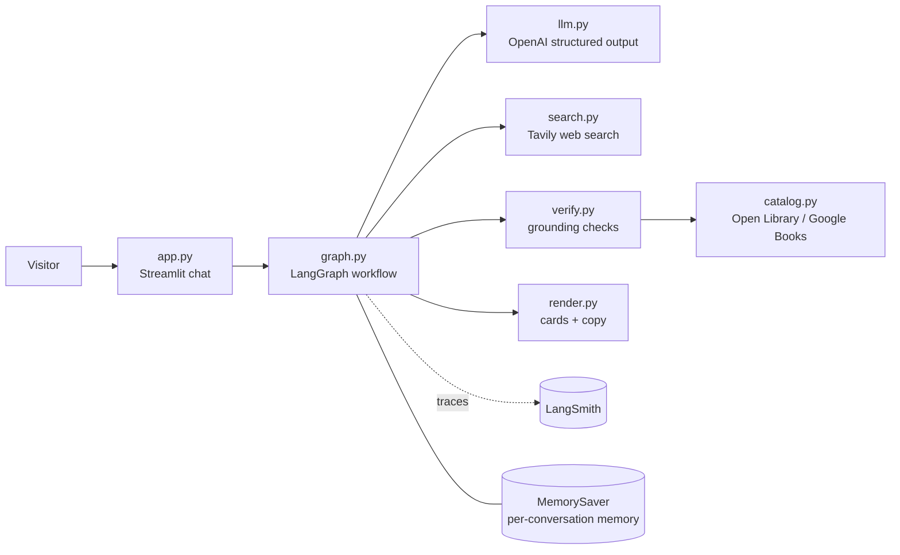
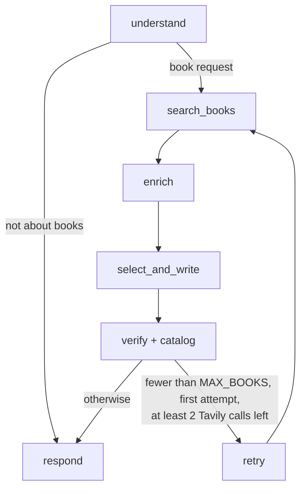

# Book Finder — Design

This document describes the system **as built**. The original pre-build design, with the
reasoning behind the product decisions, is in
[superpowers/specs/2026-11-08-book-recommender-design.md](superpowers/specs/2026-11-08-book-recommender-design.md);
the build plan is in [superpowers/plans/](superpowers/plans/).

## 1. What it is

A chat web app. A visitor types a topic ("Stoic philosophy", "cozy mysteries") and gets about 5
real books. Each book shows a cover, a rating with its source, page count and year, a short
description, one line on why it fits the request, a credited review excerpt, and links to Google
Books or Open Library. The visitor can keep chatting to refine the list ("more modern", "under
200 pages", "more like the second one") without seeing repeats.

**The core promise: nothing is shown as fact unless a source backs it.** Book existence, ratings,
review excerpts, page counts and years must come from web search results or a matching book
catalog record. Descriptions, "why it fits" and judgments like "practical" are written by the LLM
and are not presented as checked facts.

**Status:** proof of concept. It runs locally on the owner's API keys. It's built to deploy to
Streamlit Community Cloud without code changes, but it isn't deployed (see §9).

## 2. Architecture

| Module | Responsibility |
|---|---|
| `app.py` | Chat UI: history, progress labels, per-session limits, friendly errors, "New search" |
| `bookrec/config.py` | `Settings`: keys and limits from Streamlit secrets, then env / `.env`; validates every value |
| `bookrec/graph.py` | The LangGraph workflow (§3), per-message Tavily budget, the retry, memory |
| `bookrec/llm.py` | `BookLLM` interface, the prompts, `OpenAIBookLLM` |
| `bookrec/search.py` | Tavily adapter and `run_queries` (stops at the budget, de-duplicates by URL) |
| `bookrec/verify.py` | Grounding rules (§4), pure functions |
| `bookrec/catalog.py` | Catalog lookups and merging (§5) |
| `bookrec/render.py` | Book-card markdown and all user-facing messages |
| `bookrec/threads.py` | `ThreadRegistry`: caps how many conversations stay in memory |
| `bookrec/telemetry.py` | Exports LangSmith settings for LangChain |
| `bookrec/wiring.py` | Builds the real graph from settings |

The LLM, the search function and the catalog enricher are **injected**, so the whole workflow is
tested with fakes (`tests/fakes.py`) and no network calls.

## 3. One message, step by step

1. **understand:** the LLM turns the message, plus the last 6 messages of history (each cut to
   2,000 characters), into a `BookRequest`. That holds a topic, soft preferences, a "like this
   book" title, and hard limits (max pages, year range). Only explicit numbers become hard limits;
   vague words like "modern" or "short" stay soft. Off-topic messages skip straight to a polite reply.
2. **search_books:** one Tavily query ("best books about {topic} …", up to 8 results). The retry
   uses "{topic} book recommendations list" instead.
3. **enrich:** the LLM lists candidate books named in the results. Then one Tavily query per
   candidate ("{title} {author} book rating review", plus "pages" / "published" when the request
   has those limits).
4. **select_and_write:** the LLM picks up to `MAX_BOOKS` from the results only, with source URLs
   for each fact and a verbatim review excerpt. It excludes books already shown in the conversation.
5. **verify:** the grounding rules (§4), then the catalog lookups (§5), then the hard limits.
6. **retry:** once, when too few books survived and the budget allows.
7. **respond:** formats the cards and records the shown titles, so follow-ups never repeat them.

**Budget per message:** at most `MAX_TAVILY_CALLS_PER_MESSAGE` (8) Tavily calls, retry included.
Typically that's 1 search + 5 enrich calls, then 1 + 1 on a retry. Catalog lookups are free and
don't count.

**Memory:** LangGraph's `MemorySaver`, keyed by a random per-browser-session thread id. Our
Pydantic types are registered with the checkpoint serializer (`CHECKPOINT_TYPES`). `ThreadRegistry`
deletes the oldest conversations beyond `MAX_CONVERSATIONS`, and "New search" deletes the current one.

## 4. Grounding rules (`verify.py`)

All checks run on normalized text: case-folded, curly quotes made straight, ellipses removed,
whitespace collapsed. Titles are compared in normalized form: cut at `:`, `(`, ` - `, ` — `,
` by `, and with a leading "the/a/an" removed. So "The Meditations (Penguin Classics)" counts
as "meditations".

A fact must appear **near the book's title** in a result: within 150 characters of a mention.
The exception is a page whose own title starts with the book's title; the whole page then counts.
This stops a "best books" list page from lending one book's rating or page count to another.

| Fact | Kept only if… | Otherwise |
|---|---|---|
| The book | its source page mentions the title | book dropped |
| Rating | the number appears near the title with rating context ("avg", "rating", "stars", "/5", "out of 5", "N ratings"), on a 5-point scale, and not as a price or version ("$4.30", "v4.3", "4.3/10", "4.3 million") | "Rating not found" |
| Review excerpt | 20–300 characters and at least 4 words, matched as whole words in a page that mentions the title, and not preceded by "not / n't / never / no" | omitted |
| Page count | the number appears near the title, followed by "pages" | not shown |
| Year | the number appears near the title | not shown |
| Source names | derived from the URL's domain (`goodreads.com`), never from LLM text | — |
| Catalog fields | always cleared; only §5 may set them | — |

Duplicates, whether in one answer or against books already shown, are dropped by normalized title.

## 5. Book catalogs (`catalog.py`)

After grounding, each surviving book is looked up by title and first-author surname in **Open
Library** (always, no key needed) and **Google Books** (only when `GOOGLE_BOOKS_API_KEY` is set;
the keyless quota is shared and usually exhausted). Lookups run in parallel with a 6-second
timeout. A failing service just contributes nothing.

A catalog record counts only if its normalized title equals the book's and the author's surname
appears in its authors. From matching records:

- **Year:** the earliest year from any source, so a 2018 reprint of an ancient text doesn't look
  modern. One side effect: classics can show their oldest catalogued printing (for example 1626).
- **Page count:** filled only if the web didn't confirm one.
- **Rating:** filled only if the web didn't find one, and only with at least `MIN_CATALOG_RATINGS`
  (10) ratings. It's shown with its source and count ("★ 3.9 on Open Library · 32 ratings"). A
  web-found Goodreads rating always wins.
- **Cover image and links:** "Preview on Google Books" / "View on Open Library".

This runs **before** the hard limits, so a page count from a catalog can satisfy "under 200 pages".

## 6. Guardrails and limits

Every limit is a setting (env / `.env` / Streamlit secrets), validated at startup. An invalid
value stops the app with a message naming it.

| Setting | Default | Protects against |
|---|---|---|
| `MAX_BOOKS` | 5 | — (answer size) |
| `MAX_SEARCHES_PER_SESSION` | 20 | Tavily/OpenAI spend from one visitor |
| `MAX_MESSAGES_PER_SESSION` | 60 | OpenAI spend from off-topic chatter (which doesn't use a search) |
| `MAX_TAVILY_CALLS_PER_MESSAGE` | 8 | Spend per message |
| `MAX_INPUT_CHARS` | 500 | Huge pasted inputs |
| `MAX_CONVERSATIONS` | 200 | Server memory growth |
| `MIN_CATALOG_RATINGS` | 10 | Misleading small-sample catalog ratings |

Session counters live in Streamlit session state and **reset on page reload**. They slow down
casual overuse; they aren't a hard cap. Errors (missing keys, API failures) show a friendly
message, never a traceback, and failed runs don't count toward the limits.

## 7. Telemetry (LangSmith)

Optional, off by default. With `LANGSMITH_TRACING=true` and a key, each message is one
`book_finder_turn` trace containing every graph step, each OpenAI call (prompt, tokens, timing),
each Tavily query (`tavily_search`) and each catalog lookup (`open_library_lookup`,
`google_books_lookup`). Traces carry the conversation's `session_id`, so LangSmith groups one
conversation into a thread. `telemetry.py` copies the settings into environment variables because
Streamlit secrets aren't environment variables.

Everything visitors type, and the search results, is stored in the owner's LangSmith account.

## 8. Security

- Keys live in `.env` locally or Streamlit secrets when hosted. Both are git-ignored, and the
  history was checked before the repo was made public.
- Keys never go in URLs. The Google Books key is sent as the `X-Goog-Api-Key` header, so it can't
  leak through error messages, logs or traces.
- Visitors never see key values or tracebacks.
- Conversations are isolated by random thread ids that are never shown in the UI.

## 9. Known limits and next steps

**Measured (live, Nov 2026):**
- **Speed:** about 15–25 seconds per answer. Most of that is OpenAI, and the book-picking step
  varies from 2 to 8+ seconds. Catalog lookups add about 2 seconds.
- **Cost:** about 30,000 OpenAI tokens per search.

**Before sharing publicly:**
- Add a password or a global daily cap that doesn't reset on reload.
- Set a monthly spending cap in the OpenAI account and check Tavily's credit limit.
- Move memory from `MemorySaver` to SQLite so a restart doesn't drop conversations.

**Improvement ideas:**
- Run the per-book Tavily queries in parallel and stream the reply (speed).
- Send smaller result snippets to the LLM and cache popular topics (cost).
- Build a LangSmith evaluation set of about 20 topics to measure quality changes.
- Send 👍/👎 feedback on recommendations to LangSmith.
- Add "Find on Amazon" / "Find at your library" links.

**Small known issues:** "Here are 1 books"; no notice when input is cut; the displayed excerpt
uses the LLM's casing; author names aren't checked against sources.

## 10. Testing

`.venv/Scripts/python -m pytest -v` runs 94 tests with no network or keys:
- the grounding rules, including real-world rating formats found during live testing;
- catalog parsing and matching;
- the full graph with fakes (retry, budget, memory, exclusions);
- the Streamlit app through `streamlit.testing` (limits, errors, "New search", session tagging);
- the configuration.

Real APIs are used only for manual smoke tests.
